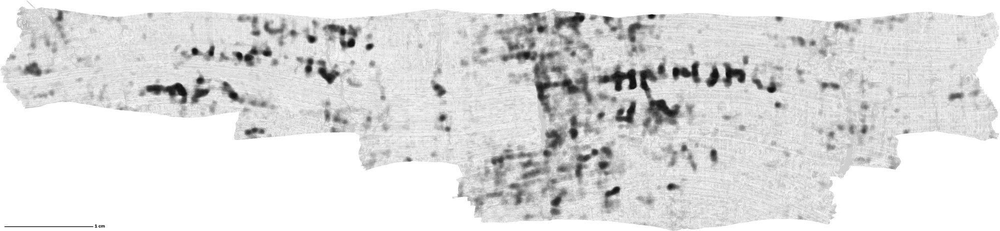

# PHerc. 0306B: a second inked area, turns 50 and 51 (surface and ink maps)

While working on the First Letters prize for PHerc. 0306B, I traced a second area of the scroll by hand, separate from the line that won the prize. It holds rows of ink on two neighboring turns of the same sheet, over about 19 cm² of surface. I turned to it after reaching the limit of what I could read on turn 73, and I was preparing it as a submission when the prize for this scroll was awarded. I am sharing the surface and the images now, so that others can hopefully read even more of this scroll.

## What is here

- `mesh/PHerc0306B_w050_w051_traced.tifxyz`: the surface in tifxyz format, already flattened (lasagna, 2.5 voxel step). It is one continuous sheet covering turn 50 and the turn after it, from z 8475 to z 10900.
- `tracing/lines.json`: the traced lines the surface was built from, one per height in level-0 voxel coordinates. Most heights are my own strokes; where I did not draw, the line follows an automatic spiral fit snapped to the m7 surface prediction.
- `images/`: the Reader V3 ink map (written face, mean of depths -5 to -3 below the surface) on its own and over the papyrus texture of the CT, and the CT on the surface alone, all over the whole traced area at 8.64 µm per pixel (the `_full` files) with a 1 cm bar. Ink is dark, on a linear scale from the median to the 99.9th percentile with no threshold. The `_preview` files are the same images at 2000 px wide.

## Scan and coordinates

- Volume: PHerc. 0306B, `20250521133212` (ESRF, 8.64 µm, 116 keV), level-0 voxels.
- The surface lies between x 3408 and 6054, y 2620 and 5296, z 8475 and 10900.
- The images are in reading orientation (rows of text run left to right).

## To render it

I rendered it with VC3D's `vc_render_tifxyz` using `--scale 1 --num-slices 66 --slice-step 1 --flip-normals --surface-interpolation smooth`. The flag `--flip-normals` is needed because this mesh's normals point toward the scroll axis. Layer 33 is the mesh surface (depth 0), and negative depths go toward the scroll's center; the ink images use Reader V3 on the mean of depths -5 to -3. The images are the render mirrored left to right, which puts them in reading orientation.

## What I saw

- A main row of clear letter forms in the right half of the image, with at least two lower rows under it.
- More rows on the next turn, in the left half of the image.
- The forms are letter-sized (about 2.5 to 3 mm), stronger on the written face than on the back, and absent when the same render is read with its ink removed (phase-randomized).
- Five public models (Reader V3, Reader v2, dnative, KLAVIS, soup43) draw the same forms.

A model fine-tuned on this scroll, like the one that won the prize, might read much more of it.

## Tools

The surface was traced in a tracing tool I built for this project, with VC3D alongside, and flattened with the villa lasagna flattener. The work was done with AI coding assistants (Claude). The data is free to use; please mention this repository if it helps.
